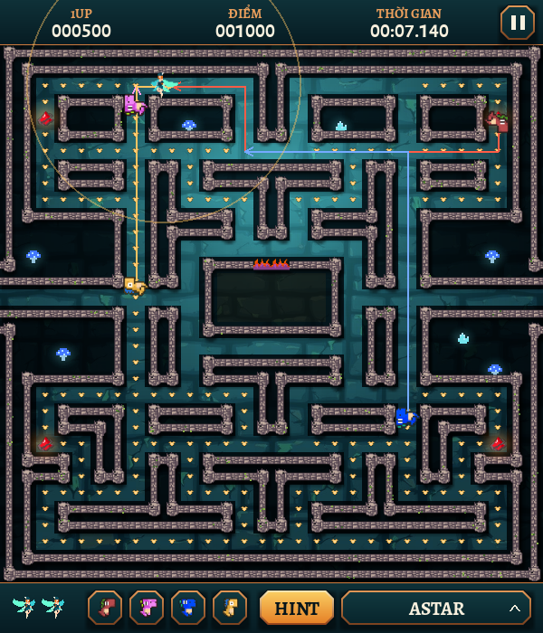

# Fairy vs Dinosaur

A maze arcade game built with Python and Pygame, where nine AI algorithms can play the game and be compared side by side.

[English](#english) | [Tiếng Việt](#tiếng-việt)



---

## English

### Overview

You control a fairy through a maze, collecting every pellet while four dinosaurs hunt you down. Power pellets turn the tables for a few seconds, letting you defeat dinosaurs for bonus points.

Instead of playing by hand, you can hand control to a search algorithm and watch it play. Each AI run is recorded, and the History screen compares the algorithms using tables and charts.

The project was created at Ho Chi Minh City University of Technology and Education (HCMUTE).

### Features

- Nine algorithms the fairy can use: BFS, DFS, UCS, A*, Greedy, Beam Search, Hill Climbing, Expectimax and MCTS
- Four dinosaurs that coordinate to cut off escape routes, with scatter, chase and frightened modes
- Path hints that visualize what the fairy and each dinosaur are planning
- Performance history with comparison charts for every algorithm
- English, Vietnamese, French and Spanish interface
- Adjustable music and sound effects, with three control schemes

### Getting started

Requirements: Python 3 (tested on 3.13) and the packages in `requirements.txt`.

```bash
git clone https://github.com/Thien21112005/fairy-vs-dinosaur.git
cd fairy-vs-dinosaur
python -m venv .venv
.venv\Scripts\activate        # Windows
source .venv/bin/activate     # macOS and Linux
pip install -r requirements.txt
python main.py
```

### How to play

| Action | Control |
|---|---|
| Move | Arrow keys or WASD, set in Settings |
| Pause and resume | Esc, or the pause button |
| Let an algorithm play | Click SOLVE and choose an algorithm |
| Show planned paths | Click HINT |
| Show or hide a dinosaur | Click B, P, I or C |

Choosing an algorithm and pressing a movement key are mutually exclusive: the first one you use locks the mode for that game. Only AI games are recorded in History.

### Algorithms

The fairy asks the chosen algorithm where to go each time it reaches a new cell, except DFS and Hill Climbing, which walk their whole route first.

**Search algorithms** look for a route to a pellet.

| Algorithm | How it chooses | Avoids dinosaurs |
|---|---|---|
| BFS | Fewest steps to the closest pellet | Only the cell a dinosaur stands on |
| DFS | First pellet found going deep. It clears the level but takes far longer than the others | Only the cell a dinosaur stands on |
| UCS | Lowest total cost. Pellets are cheap, empty cells cost more and cells near a dinosaur cost much more | By cost |
| A* | Same result as UCS, using a distance estimate to explore fewer cells | By cost |
| Greedy | Whatever looks closest to a pellet, ignoring the cost so far | Refuses cells within 2 steps |
| Beam Search | Like A*, but keeps only the 5 best candidates at each depth | Refuses cells within 2 steps |
| Hill Climbing | Moves at random towards neighbours that get closer to a pellet | Refuses cells within 2 steps |

**Look-ahead algorithms** simulate what the dinosaurs may do next, using real walking distances. They also hunt dinosaurs during power mode.

| Algorithm | How it chooses |
|---|---|
| Expectimax | Alternates the fairy's best move with the likely moves of the 2 nearest dinosaurs, and searches deeper until it reaches a fixed work limit |
| MCTS | Plays 90 short simulated games from the current position, focuses on the moves that do well, and picks the one tried most |

Expectimax is the strongest overall at level 1. MCTS is limited by how few simulations fit in a frame, so it is weaker than Expectimax. From level 5 the dinosaurs usually beat every algorithm.

### Dinosaurs

Each dinosaur alternates between patrolling its own corner and chasing. During chase, they split up the fairy's escape routes:

| Dinosaur | Role during chase |
|---|---|
| Blinky | Chases the fairy directly, and speeds up when few pellets remain |
| Pinky | Heads for the junction ahead of the fairy |
| Inky | Heads for the nearest remaining junction |
| Clyde | Covers a remaining junction when far away, and retreats to its patrol when within 8 cells |

Any dinosaur within 3 cells goes straight for the fairy. All of them get faster as levels increase. A defeated dinosaur returns home as an egg and hatches; it cannot be defeated again until the next power pellet.

### History screen

| Value | Meaning |
|---|---|
| Time | Total time spent searching, in seconds |
| Nodes | Total nodes expanded, or positions simulated for the look-ahead algorithms |
| Path | Cells the fairy actually walked |
| Memory | Peak memory use, estimated from the size of the search structures |
| Success | Share of games that cleared the level |

### Project structure

```
main.py                  Entry point
assets/                  Images and sounds
data/                    Settings and history, created on first run and not tracked by git
tests/                   Automated tests
fairy_vs_dinosaur/
    config.py            File locations
    settings_store.py    Reads and writes settings
    audio/               Sound effects and music
    core/                Game loop, input, rendering, level and history
    entities/            Fairy, dinosaurs and their coordination
    i18n/                Translations
    pathfinding/         The nine algorithms, their shared base class and the simulation model
    ui/                  HUD, overlay menus and full-screen menus
```

### Running the tests

```bash
python -m unittest discover -s tests -t .
```

The tests run without a window or sound device and take about a minute. They do not touch your saved settings or history.

### Team

| Member | Role |
|---|---|
| Nguyễn Ngọc Thiện | Lead programmer: gameplay, AI pathfinding and systems integration |
| Nghiêm Phú Đăng Quân | UI/UX and sound: interface, menus and audio |
| Nguyễn Quốc Khoa | Graphics and levels: assets, level layouts and visual effects |

### License

The source code is released under the [MIT License](LICENSE). Files in `assets/` may be subject to the terms of their original creators and are not covered by this license.

---

## Tiếng Việt

### Giới thiệu

Bạn điều khiển một nàng tiên đi qua mê cung, ăn hết các hạt trong khi bốn con khủng long săn đuổi. Hạt năng lượng đảo ngược tình thế trong vài giây, cho phép bạn hạ khủng long để nhận điểm thưởng.

Thay vì tự chơi, bạn có thể giao quyền điều khiển cho một thuật toán tìm kiếm và xem nó chơi. Mỗi lượt chơi bằng AI đều được lưu lại, và màn hình History so sánh các thuật toán bằng bảng và biểu đồ.

Dự án được thực hiện tại Trường Đại học Sư phạm Kỹ thuật TP.HCM (HCMUTE).

### Tính năng

- Chín thuật toán cho nàng tiên: BFS, DFS, UCS, A*, Greedy, Beam Search, Hill Climbing, Expectimax và MCTS
- Bốn con khủng long phối hợp chặn lối thoát, với các chế độ tản ra, truy đuổi và hoảng sợ
- Gợi ý đường đi, hiển thị kế hoạch của nàng tiên và từng con khủng long
- Lịch sử hiệu năng với biểu đồ so sánh các thuật toán
- Giao diện tiếng Anh, tiếng Việt, tiếng Pháp và tiếng Tây Ban Nha
- Tùy chỉnh nhạc nền, hiệu ứng âm thanh và ba kiểu điều khiển

### Cài đặt và chạy

Yêu cầu: Python 3 (đã kiểm thử trên 3.13) và các gói trong `requirements.txt`.

```bash
git clone https://github.com/Thien21112005/fairy-vs-dinosaur.git
cd fairy-vs-dinosaur
python -m venv .venv
.venv\Scripts\activate        # Windows
source .venv/bin/activate     # macOS và Linux
pip install -r requirements.txt
python main.py
```

### Cách chơi

| Thao tác | Điều khiển |
|---|---|
| Di chuyển | Phím mũi tên hoặc WASD, chọn trong Settings |
| Tạm dừng và tiếp tục | Esc, hoặc nút tạm dừng |
| Để thuật toán chơi | Bấm SOLVE rồi chọn thuật toán |
| Hiện đường đi dự kiến | Bấm HINT |
| Hiện hoặc ẩn một con khủng long | Bấm B, P, I hoặc C |

Chọn thuật toán và bấm phím di chuyển loại trừ nhau: thao tác nào dùng trước sẽ khóa chế độ của ván đó. Chỉ các ván chơi bằng AI mới được lưu vào History.

### Các thuật toán

Mỗi khi tới một ô mới, nàng tiên hỏi thuật toán đang chọn nên đi đâu. Riêng DFS và Hill Climbing đi hết đường đã tìm rồi mới tìm tiếp.

**Nhóm tìm đường** tìm lối tới một hạt.

| Thuật toán | Cách chọn | Né khủng long |
|---|---|---|
| BFS | Ít bước nhất tới hạt gần nhất | Chỉ tránh đúng ô khủng long đang đứng |
| DFS | Hạt đầu tiên gặp khi đi theo chiều sâu. Vẫn hoàn thành màn nhưng lâu hơn hẳn các thuật toán khác | Chỉ tránh đúng ô khủng long đang đứng |
| UCS | Tổng chi phí thấp nhất. Hạt có chi phí thấp, ô trống cao hơn, ô gần khủng long cao hơn nhiều | Qua chi phí |
| A* | Cùng kết quả với UCS, dùng ước lượng khoảng cách để duyệt ít ô hơn | Qua chi phí |
| Greedy | Ô có vẻ gần hạt nhất, không tính chi phí đã đi | Không đi vào ô cách khủng long từ 2 bước trở xuống |
| Beam Search | Giống A* nhưng chỉ giữ 5 ứng viên tốt nhất ở mỗi độ sâu | Không đi vào ô cách khủng long từ 2 bước trở xuống |
| Hill Climbing | Đi ngẫu nhiên tới ô kề gần hạt hơn | Không đi vào ô cách khủng long từ 2 bước trở xuống |

**Nhóm nhìn trước** giả lập các nước khủng long có thể đi, dùng khoảng cách đường đi thật. Hai thuật toán này còn chủ động săn khủng long khi có năng lượng.

| Thuật toán | Cách chọn |
|---|---|
| Expectimax | Xen kẽ nước tốt nhất của nàng tiên với các nước có khả năng của 2 con khủng long gần nhất, đào sâu dần tới giới hạn công việc cố định |
| MCTS | Chơi 90 ván giả lập ngắn từ vị trí hiện tại, tập trung vào các nước cho kết quả tốt và chọn nước được thử nhiều nhất |

Expectimax mạnh nhất ở level 1. MCTS bị giới hạn vì mỗi khung hình chỉ đủ thời gian cho ít ván giả lập nên yếu hơn Expectimax. Từ level 5, khủng long thường thắng mọi thuật toán.

### Khủng long

Mỗi con luân phiên giữa tuần tra góc riêng và truy đuổi. Khi truy đuổi, chúng chia nhau các lối thoát của nàng tiên:

| Khủng long | Vai trò khi truy đuổi |
|---|---|
| Blinky | Đuổi thẳng, và tăng tốc khi còn ít hạt |
| Pinky | Tới ngã rẽ phía trước nàng tiên |
| Inky | Tới ngã rẽ gần nó nhất trong số còn lại |
| Clyde | Lấp ngã rẽ còn trống khi ở xa, và lùi về vòng tuần tra khi cách dưới 8 ô |

Con nào cách nàng tiên từ 3 ô trở xuống sẽ lao thẳng vào. Tất cả nhanh dần theo level. Khủng long bị hạ sẽ về nhà dưới dạng trứng rồi nở lại, và không thể bị hạ tiếp cho tới hạt năng lượng kế tiếp.

### Màn hình History

| Giá trị | Ý nghĩa |
|---|---|
| Time | Tổng thời gian tìm đường, tính bằng giây |
| Nodes | Tổng số nút đã mở rộng, hoặc số vị trí đã giả lập với nhóm nhìn trước |
| Path | Số ô nàng tiên thực sự đã đi |
| Memory | Bộ nhớ cao nhất, ước lượng theo kích thước các cấu trúc tìm kiếm |
| Success | Tỷ lệ ván hoàn thành màn chơi |

### Cấu trúc dự án

```
main.py                  Điểm chạy chương trình
assets/                  Hình ảnh và âm thanh
data/                    Settings và history, tự tạo khi chạy lần đầu, không đưa lên git
tests/                   Kiểm thử tự động
fairy_vs_dinosaur/
    config.py            Đường dẫn file
    settings_store.py    Đọc và ghi settings
    audio/               Hiệu ứng âm thanh và nhạc nền
    core/                Vòng lặp game, xử lý nhập, vẽ, màn chơi và lịch sử
    entities/            Nàng tiên, khủng long và cách chúng phối hợp
    i18n/                Bản dịch
    pathfinding/         Chín thuật toán, lớp cơ sở dùng chung và mô hình giả lập
    ui/                  HUD, menu nổi và các màn hình menu
```

### Chạy kiểm thử

```bash
python -m unittest discover -s tests -t .
```

Bộ kiểm thử chạy không cần cửa sổ hay thiết bị âm thanh, mất khoảng một phút và không ảnh hưởng tới settings hay history đã lưu.

### Nhóm thực hiện

| Thành viên | Vai trò |
|---|---|
| Nguyễn Ngọc Thiện | Lập trình chính: lối chơi, thuật toán tìm đường và tích hợp hệ thống |
| Nghiêm Phú Đăng Quân | Giao diện và âm thanh: giao diện, menu và âm thanh |
| Nguyễn Quốc Khoa | Đồ họa và màn chơi: tài nguyên, bố cục màn chơi và hiệu ứng hình ảnh |

### Giấy phép

Mã nguồn được phát hành theo [Giấy phép MIT](LICENSE). Các file trong `assets/` có thể thuộc điều khoản của tác giả gốc và không nằm trong phạm vi giấy phép này.
